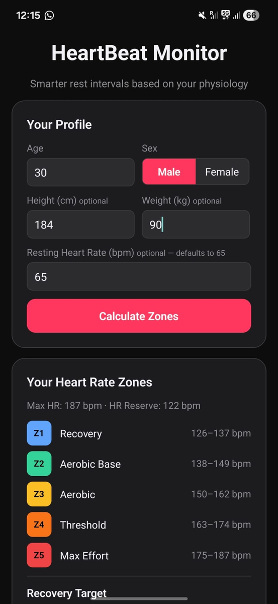
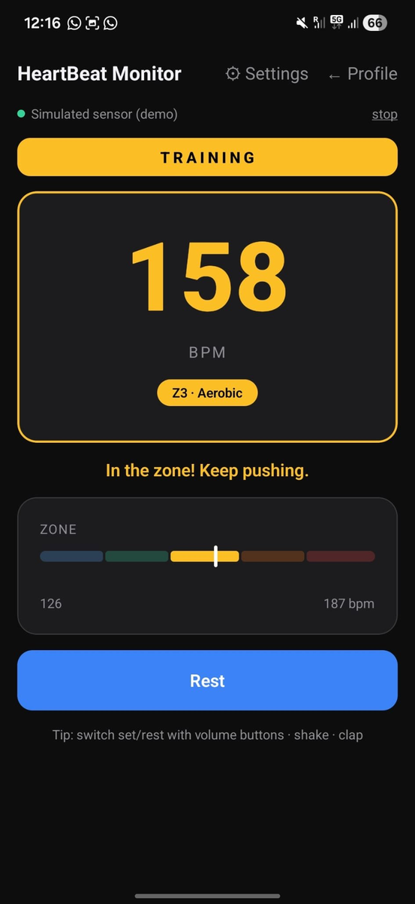
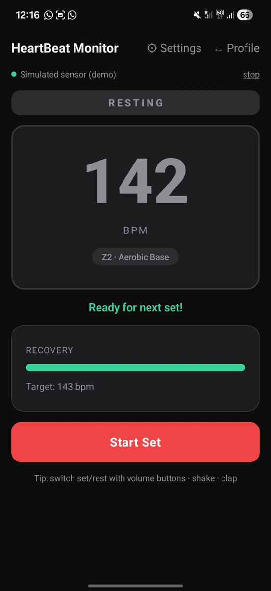
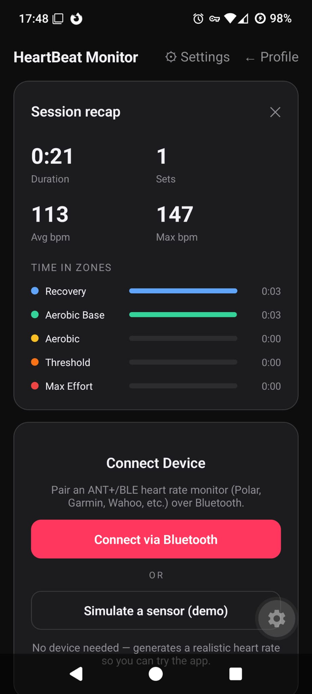
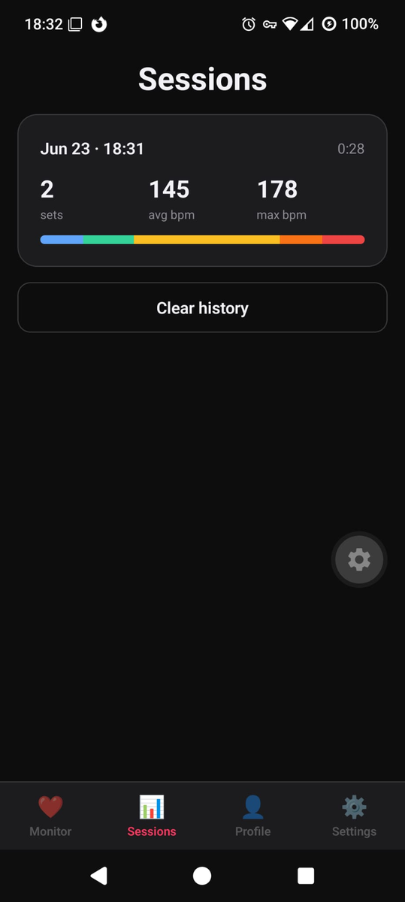
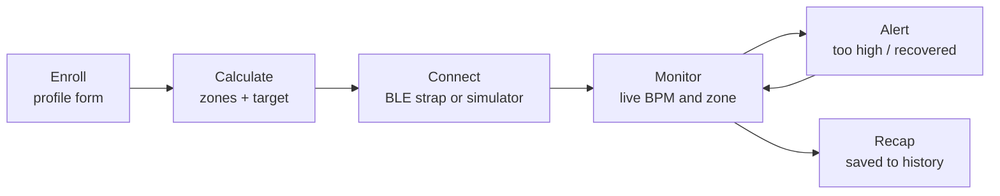
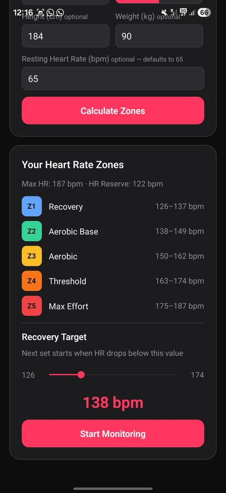
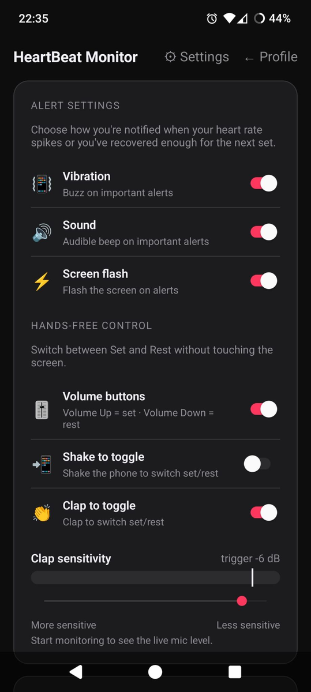
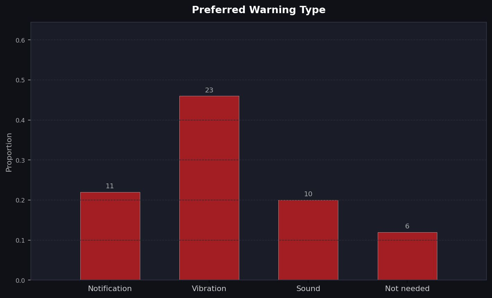

# Pulse Pilot · HeartBeat Monitor

**Smarter rest, tuned to your own heart** · Human–Computer Interaction on the Web, Sapienza Università di Roma, 2025/2026

Most workout apps tell you to rest for a fixed 60 or 90 seconds. How fast your
heart actually recovers depends on your age, fitness and how hard the last set
was, so a fixed timer is too short for some people and too long for others.
Pulse Pilot reads your heart rate from a Bluetooth chest strap and tells you
when you have recovered enough to start the next set.

<p align="center">
  
  
  
  
  
</p>

- **Personal zones.** One short form (age, sex, optional height and weight,
  resting heart rate) gives five heart-rate zones and a recovery target.
- **Live monitor.** A large BPM readout, the current zone and a recovery bar.
  The screen turns from "In the zone! Keep pushing." to "Ready for next set!"
  when you reach the target.
- **Alerts you do not have to look at.** Vibration, sound and a screen flash,
  each switchable on its own.
- **Hands-free control.** Volume buttons, a shake or a clap switch between
  set and rest.
- **Session history.** Each workout is saved with its duration, sets, average
  and maximum heart rate, and time spent in each zone.
- **Offline.** No account and no network. Everything stays on the phone.

[Demo video](https://drive.google.com/file/d/1zJfv81FyJeLUjK768PgSjUyidrHYWkxN/view?usp=sharing) ·
[Presentation (PDF)](docs/presentation/Pulse_Pilot.pdf) ·
[Android APK](../../releases/latest)

## Team

| Name | Student ID |
|---|---|
| Valentina Emili | 2005356 |
| Guglielmo Felici | 1706240 |
| Özgür Cihan Karahan | 2233702 |
| Taha Kutay Serin | 2242412 |

The project was first developed in
[Guglielmo's GitLab repository](https://gitlab.com/guglielmofelici/heartbeat-monitor-native).
This repository holds the final version of the code together with the
presentation.

## How the app works



### Heart-rate zones

Maximum heart rate uses the Tanaka formula, and the zones use the heart-rate
reserve (Karvonen) method, so two people with the same age but a different
resting heart rate get different zones.

```
maxHR   = 208 − 0.7 × age
reserve = maxHR − restingHR
zone    = restingHR + reserve × %
```

| Zone | Name | % of reserve | Example: age 30, resting 65 |
|---|---|---|---|
| Z1 | Recovery | 50–60% | 126–137 bpm |
| Z2 | Aerobic Base | 60–70% | 138–149 bpm |
| Z3 | Aerobic | 70–80% | 150–162 bpm |
| Z4 | Threshold | 80–90% | 163–174 bpm |
| Z5 | Max Effort | 90–100% | 175–187 bpm |

The recovery target starts at the top of Z1 (60% of reserve). A slider lets the
user move it anywhere between the bottom of Z1 and the start of Z3, because a
beginner may want a lower target than a trained athlete. The code is in
[`src/utils/hrCalculations.ts`](src/utils/hrCalculations.ts).

<p align="center">
  
  
</p>

### Alerts

The monitor fires an alert on two events, once each time the event starts, so
a noisy reading does not repeat it:

| Event | When | Vibration | Sound |
|---|---|---|---|
| Too high | During a set, heart rate enters Z5 | three short buzzes | three high beeps |
| Recovered | During rest, heart rate reaches the recovery target | one buzz | one low beep |

The screen flash is optional and pulses the screen twice. Switching between set and rest gives a separate light buzz, so the
hands-free controls can be used without looking at the phone.

### Hands-free control

During a set your hands are busy and the phone is often on the floor, so we
added three optional ways to switch between set and rest. All of them work
offline and only listen while the monitor is live.

- **Volume buttons:** Volume Up starts a set, Volume Down starts a rest. The
  media volume is kept at the middle while the monitor is open so both buttons
  always register.
- **Shake:** a shake above about 1.8 g, with a 1.2-second cooldown, using the
  accelerometer.
- **Clap:** a jump in microphone loudness above a threshold the user sets with
  a slider. It only measures loudness, with no speech recognition, and ignores
  the first half second after the microphone starts.

### Bluetooth and the simulator

The app connects to any strap that implements the standard Bluetooth GATT Heart
Rate Service (Polar, Garmin, Wahoo and similar) and reads the Heart Rate
Measurement characteristic. Our chest strap arrived late, so we first wrote a
simulator that produces a realistic heart rate for each phase: it rises quickly
during a set, falls slowly during rest and adds random noise. After ten seconds
of a set it keeps climbing past the maximum, which lets us test the "too high"
alert. The monitor reads the heart rate the same way from both sources, so the
whole interface was built and tested before the hardware existed, and the
simulator stays in the app as a demo mode.

## User research

We ran a survey with 50 people (72% men, 28% women, mean age about 27) before
fixing the design. Most of them work out regularly, and many have already
tried heart-rate tracking.

<p align="center">
  
</p>

46% chose vibration, more than any other option, so vibration is on by
default. The other changes that came from the feedback:

- a clear "connect your sensor" step, so users know the strap is needed;
- plain zone names (Recovery, Threshold and so on) next to the percentages;
- a visible "Ready for next set!" message when recovery is complete.

## Run it

### Install the APK

Download the APK from the [latest release](../../releases/latest) and open it on
an Android phone. Android will ask you to allow installs from this source. Use
**Simulate a sensor (demo)** on the monitor screen if you do not have a chest
strap.

### Build from source

The app uses native modules (Bluetooth, volume buttons, sensors and audio), so it
runs as an Expo development build rather than in Expo Go. You need Node.js
20.19.4 or newer, Android Studio with the Android SDK, and a physical phone,
because Bluetooth and the volume buttons need real hardware.

```bash
npm install
npm run android   # builds and installs the development build on a connected phone
npm start         # starts the JS server for fast reloads after the first install
```

To build an installable APK with EAS:

```bash
npx eas-cli build --platform android --profile preview
```

| Command | What it does |
|---|---|
| `npm run prebuild` | Regenerates the native `android/` and `ios/` projects |
| `npm run typecheck` | Runs the TypeScript type check |
| `npm run lint` | Runs ESLint |

The `android/` and `ios/` folders are generated and git-ignored. Bluetooth,
microphone and audio permissions are declared in [`app.json`](app.json).

## Code layout

| Path | Contents |
|---|---|
| `App.tsx` | Shows the profile form, then the tabbed app |
| `src/components/Onboarding.tsx` | Profile form, zone table and recovery slider |
| `src/components/Monitor.tsx` | Live view, alert triggers and sensor connection |
| `src/components/Sessions.tsx` | Saved workouts with time in each zone |
| `src/components/SettingsScreen.tsx` | Alert channels, hands-free switches and clap sensitivity |
| `src/components/TabShell.tsx`, `ProfileScreen.tsx` | Tab bar and profile editing |
| `src/hooks/useHeartRate.ts` | Bluetooth scan, connection and heart-rate parsing |
| `src/hooks/useSimulatedHR.ts` | Simulated heart rate for demo and testing |
| `src/hooks/useAlerts.ts` | Vibration and sound alerts, saved settings |
| `src/hooks/useVolumeButtons.ts`, `useShakeControl.ts`, `useClapControl.ts` | Hands-free controls |
| `src/hooks/useSessionRecap.ts`, `useSessionHistory.ts` | Workout statistics and the saved history (last 50 sessions) |
| `src/utils/hrCalculations.ts` | Maximum heart rate, zones and recovery target |
| `assets/` | Beep sounds |
| `docs/` | Presentation and screenshots |

Built with React Native 0.85, Expo SDK 56 and TypeScript, using
`react-native-ble-plx`, `expo-sensors`, `expo-audio`,
`react-native-volume-manager` and AsyncStorage.

## Limitations and next steps

- **Not a medical device.** The zones are general fitness guidance from
  population formulas, not clinical monitoring.
- **Sensor dependent.** The readings are only as good as the chest strap.
- **Small survey.** 50 respondents, mostly young men; a larger and more
  balanced group might prefer other alert types.
- **Next:** start the next set automatically when recovery is reached, show
  progress across sessions, and test the design with a wider user group.

## References

1. Tanaka, H., Monahan, K. D. and Seals, D. R. (2001). Age-predicted maximal
   heart rate revisited. *Journal of the American College of Cardiology*,
   37(1), 153–156. [doi:10.1016/S0735-1097(00)01054-8](https://doi.org/10.1016/S0735-1097(00)01054-8)
2. Karvonen, M. J., Kentala, E. and Mustala, O. (1957). The effects of training
   on heart rate: a longitudinal study. *Annales Medicinae Experimentalis et
   Biologiae Fenniae*, 35(3), 307–315. PMID 13470504.
